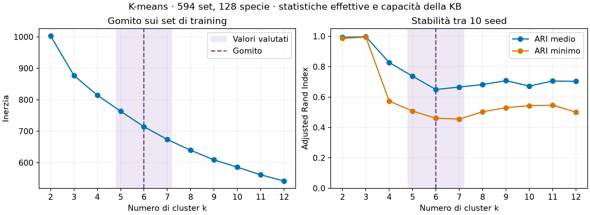

# Profili dei set e completamento della squadra avversaria

K-means usa soltanto i 594 set del catalogo di training, relativi a 128 specie base. Le variabili sono sei statistiche effettive e dodici capacità inferite dalla KB. Le statistiche vengono standardizzate singolarmente. I due blocchi sono poi riscalati per avere la stessa varianza totale, lasciando le capacità rare sullo stesso fattore di scala delle capacità comuni.

## Scelta dei candidati

Per ogni k da 2 a 12 sono stati eseguiti dieci seed con dieci inizializzazioni ciascuno. L'inerzia e la silhouette descrivono la soluzione con inerzia più bassa. L'ARI confronta le 45 coppie di partizioni ottenute cambiando seed, mantenendo fisso il catalogo. Il gomito è il punto di massima distanza verticale dalla corda degli estremi sulla curva normalizzata. Lo scostamento è 0,226 e seleziona k=6. Per il confronto predittivo proviamo il gomito e i suoi due vicini.

| k | Inerzia | ARI medio | ARI minimo | Silhouette |
|---:|---:|---:|---:|---:|
| 5 | 763,33 | 0,737 | 0,508 | 0,155 |
| 6 | 714,30 | 0,650 | 0,461 | 0,162 |
| 7 | 673,60 | 0,666 | 0,455 | 0,167 |

Per confronto, a k=3 l'ARI medio è 0,997. I gruppi più dettagliati presentano maggiore sensibilità all'inizializzazione. La silhouette resta bassa per i tre candidati e suggerisce separazione debole.

## Lettura delle schede a k=6

| Cluster | Set / specie | Tratti osservati | Set vicino al centro | Set al confine |
|---:|---:|---|---|---|
| 0 | 126 / 41 | Attacco speciale e velocità sopra la media | Walking Wake, Manaphy | Magnezone, Tinkaton |
| 1 | 155 / 33 | Attacco fisico e velocità sopra la media, 28% con rimozione hazard | Rillaboom, Quaquaval, Ogerpon-Wellspring | Ursaluna, Ogerpon-Cornerstone |
| 2 | 83 / 25 | Attacco fisico medio 369 contro 256 nel catalogo, 84% con attacchi a priorità positiva | Scizor, Ceruledge, Kingambit | Blaziken, Overqwil |
| 3 | 59 / 16 | Attacco speciale medio 351, tutti i set con setup speciale rilevato | Iron Crown, Raging Bolt | Manaphy, Gholdengo |
| 4 | 79 / 22 | Lenti e con difesa speciale elevata, 46% con hazard | Muk-Alola, Slowking-Galar | Glimmora, Grimmsnarl |
| 5 | 92 / 33 | Difesa fisica media 326 contro 243 nel catalogo, 52% con recupero, 50% pivot | Hippowdon, Corviknight, Moltres | Ursaluna, Landorus-Therian |

Gli esempi identificano set concreti, con strumenti e mosse in `audit.json`. Le schede per k=5,6,7 riportano anche le medie di tutte le variabili. Il margine fra le distanze dai due centroidi più vicini individua i casi di confine. Il cluster 5 ricorda un profilo da *wall* fisico o pivot difensivo, mentre il cluster 3 ricorda un profilo di setup speciale. Questa è un'interpretazione qualitativa ispirata alla distinzione di [TeamVerify](https://doi.org/10.32473/flairs.v34i1.128544). Le sue regole ontologiche non sono state eseguite sui set e i nomi descrivono tendenze del gruppo.

## Confronto predittivo

Si riusano le stesse squadre e maschere di training e validation di Pokémon2Vec. Il modello mantiene 32 dimensioni, 35 epoche e i tre seed originali. Ogni specie riceve il profilo medio dei suoi set nel catalogo train. Nella variante KB, ogni componente è la frazione dei set con una certa capacità. Nella variante K-means, ogni componente è la frazione dei set nel cluster corrispondente. I profili dei cinque membri noti vengono mediati e concatenati all'input del modello insieme a un indicatore di copertura del catalogo. La media assegna lo stesso peso a ogni set del catalogo e non stima la frequenza dei set realmente giocati.

| Input | Top-1 | Top-5 | Log loss | Δ top-5 vs identità (IC 95%) |
|---|---:|---:|---:|---:|
| identity | 20.70% | 45.43% | 3.5960 | riferimento |
| kb | 20.60% | 46.23% | 3.5800 | +0.80 pp [+0.18, +1.44] |
| k5 | 20.27% | 45.46% | 3.5932 | +0.03 pp [-0.55, +0.62] |
| k6 | 20.75% | 45.78% | 3.5859 | +0.35 pp [-0.27, +0.97] |
| k7 | 20.28% | 45.28% | 3.6019 | -0.15 pp [-0.69, +0.40] |

La copertura dei profili è 90.75% dei membri nelle squadre di validation. Gli intervalli bootstrap appaiati usano 10.000 ricampionamenti per squadra. Sono descrittivi sulla validation già usata per le scelte. Il migliore k è 6. La variante KB ottiene il top-5 e la log loss migliori in questo confronto. Gli intervalli delle tre varianti K-means rispetto alle sole identità includono zero. Per la KB, la differenza è +0,80 punti e il suo intervallo descrittivo esclude zero. La conferma richiede composizioni riservate per questo nuovo confronto.

Riproduzione da root con l'ambiente del progetto. Eseguire `.venv/bin/python scripts/run_team_profile_extension.py audit` e poi `.venv/bin/python scripts/run_team_profile_extension.py evaluate --workers 4`. Risultati per tutti i k e schede complete in `audit.json`. Confronti appaiati in `validation.json`.

## Conferma su uno shard riservato

Il protocollo ha fissato prima del confronto le due varianti, i 4.643 esempi di composizione del training, la configurazione 32 dimensioni e 35 epoche, i tre seed e il top-5 come metrica principale. Lo shard 35 di PokéChamp è stato escluso perché non conteneva replay Gen 9 OU. Il test finale usa [Metamon Raw Replays, shard 31](https://huggingface.co/datasets/jakegrigsby/metamon-raw-replays/resolve/060367c26630e0d36308fd42673e5cf2f4b4421a/data/train-00031-of-00046.parquet) della stessa revisione dello shard Metamon già usato. Sono state rimosse 1.786 composizioni presenti nel precedente benchmark di completamento o nel catalogo. Restano 3.444 composizioni e 20.664 maschere. Il bootstrap usa 10.000 repliche e rispetta il raggruppamento per composizione.

| Input | Top-1 | Top-5 | Log loss sui target in vocabolario |
|---|---:|---:|---:|
| Sole identità | 18,53% | 43,01% | 3,7063 |
| Identità e capacità della KB | 18,68% | 43,19% | 3,6963 |

La differenza principale è +0,18 punti di top-5, IC 95% [−0,16; +0,52]. Il guadagno osservato in validation non si conferma sul top-5 del nuovo test. La differenza secondaria di log loss è −0,00996, IC [−0,01601; −0,00390], calcolata sui 20.622 target in vocabolario. I 42 target fuori vocabolario contano come errori nel top-k. Il catalogo fornisce un profilo al 90,21% dei membri delle squadre. Il test separa le composizioni su uno shard diverso della stessa fonte. Il disegno non separa per giocatore o per periodo.

Protocollo in `config/team_profiles_external_v1.json`, composizioni e hash della fonte in `data/processed/team_completion_v1/external_metamon31.json`, risultati in `external_validation.json`. Il confronto si ripete con `.venv/bin/python scripts/run_team_profiles_external.py evaluate`.
